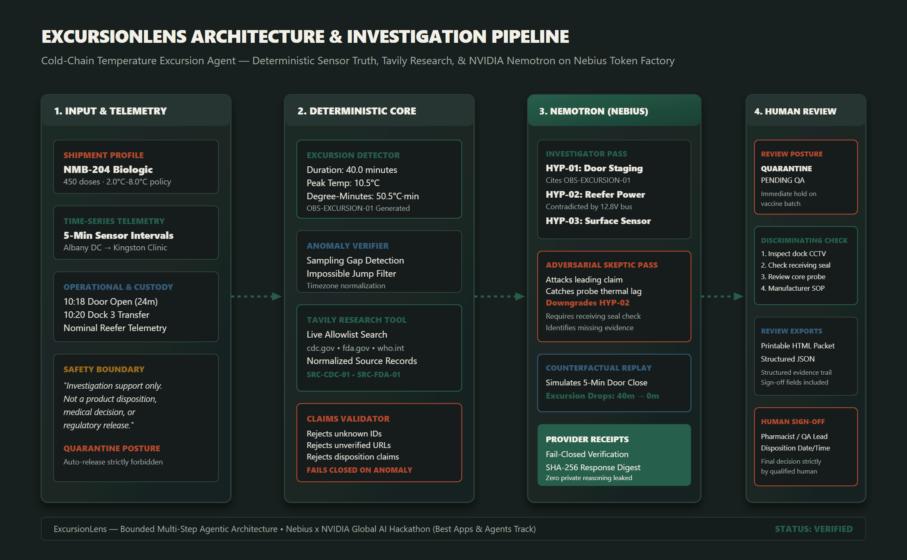
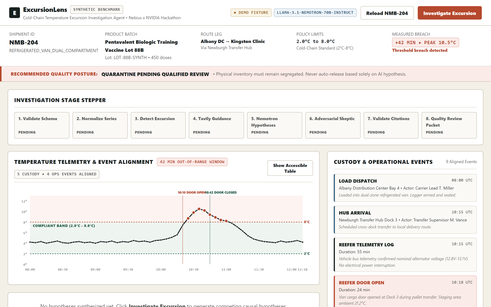
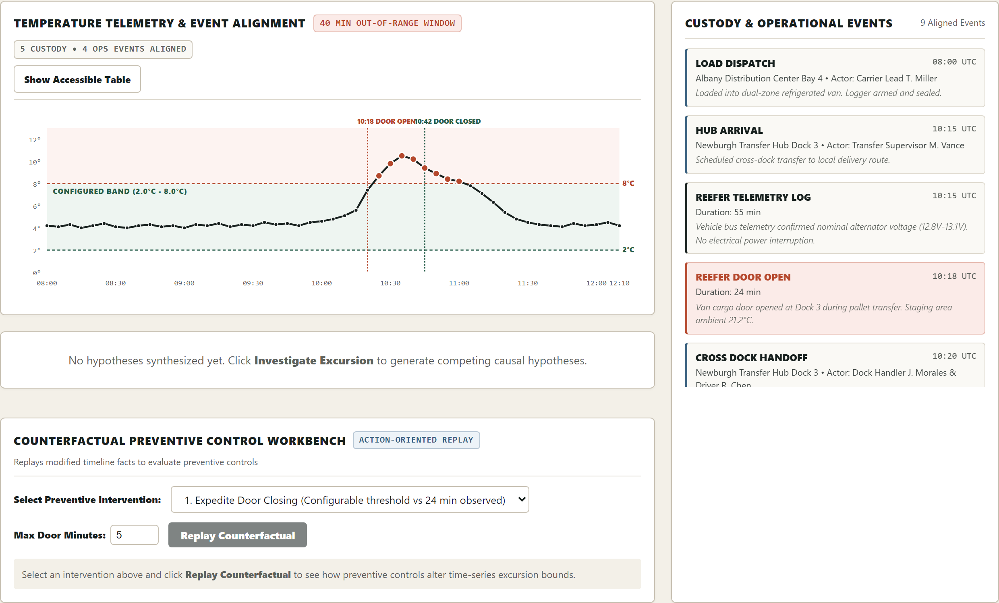
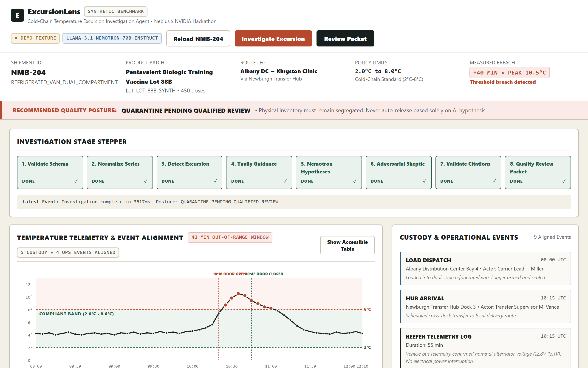
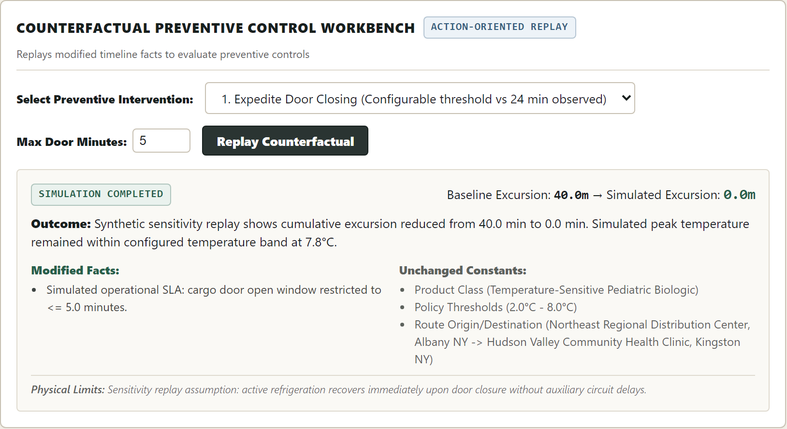
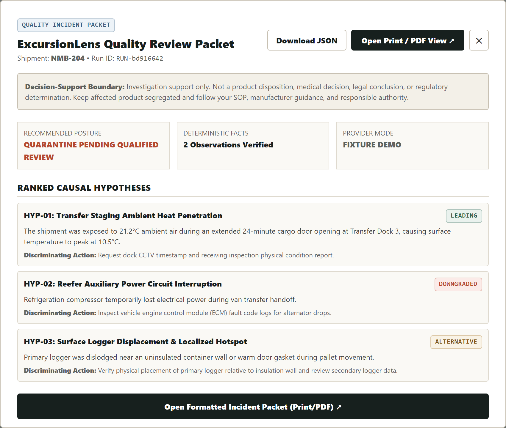
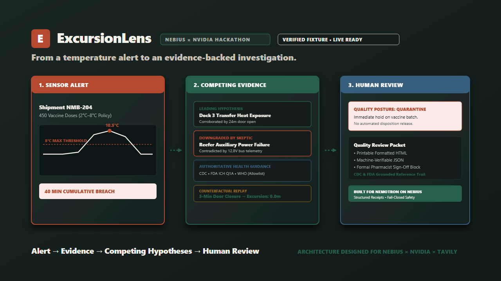

# ExcursionLens

**Evidence-first operational agent for biopharmaceutical cold-chain temperature excursion forensics.**  
*Designed to use NVIDIA Nemotron through Nebius Token Factory. Current committed execution evidence is fixture mode; live verification remains blocked pending credentials.*

[](docs/verification-results.json)
[-275E4B?style=for-the-badge&logo=w3c)](tests/e2e/journey.spec.ts)
[-275E4B?style=for-the-badge&logo=speedtest)](benchmark/run_benchmark.py)
[](apps/api/tests)
[](LICENSE)

---

## Architecture Overview



---

## Hackathon Tracks

- **Primary Track:** *Best Apps and Agents*
- **Bonus Track:** *Best Use of Tavily*

---

## The Problem: The $35 Billion Cold-Chain Blindspot

Every year, over **$35 billion in critical biopharmaceuticals, vaccines, and biologics** are discarded or compromised due to cold-chain temperature excursions during multimodal distribution. 

In life sciences operations:
1. **The Investigation Bottleneck:** When an Internet-of-Things (IoT) temperature logger alarms at receiving dock, operations teams must manually reconcile disjointed sensor logs, delivery manifests, and vehicle telemetry to understand if the breach penetrated the liquid core of the vial or merely warmed surface air during pallet handoff.
2. **Why Generic AI Fails:** Standard unconstrained LLM wrappers are hazardous in regulated operations. They hallucinate approvals, invent regulations, and attempt unauthorized product release determinations.

### The ExcursionLens Solution
ExcursionLens combines a **100% deterministic domain foundation** with **bounded agentic causal reasoning**:
- **Deterministic Core:** Zero AI tokens in temperature calculations. Window detection, 40.0-min duration, 10.5°C peak breach, rate-of-change, and 50.5°C·min Area Under the Curve (AUC) are pure mathematical calculations.
- **Authoritative Grounding:** Real-time search through Tavily restricted to trusted public health domains (`cdc.gov`, `fda.gov`, `who.int`, `gs1.org`).
- **NVIDIA Nemotron via Nebius Token Factory:** Deep causal hypothesis generation across competing operational explanations.
- **Adversarial Skeptic Pass:** An adversarial critique systematically audits hypotheses against physical telemetry (e.g., verifying vehicle bus voltage directly disproves reefer auxiliary power failure).
- **Quality Posture Boundary:** The system is architecturally barred from making final release dispositions. All investigations conclude in `QUARANTINE_PENDING_QUALIFIED_REVIEW` with an auditable human-review packet.

> **Decision-Support Boundary Notice:** ExcursionLens outputs are investigation-support evidence generated from synthetic or user-supplied telemetry. They do not determine product safety, potency, regulatory compliance or disposition. Follow organizational SOPs and obtain review from an authorized quality professional.

---

## Product Screenshots & User Journey

| 01. Case Overview & Deterministic Baseline | 02. Timeline & Telemetry Alignment |
|:---:|:---:|
| [](docs/assets/screenshots/01_case_overview.png) | [](docs/assets/screenshots/02_timeline_evidence.png) |
| Ingests raw telemetry and computes breach metrics before any AI invocation. | Correlates 5-min logger readings with custody and door-open events. |

| 03. Competing Hypotheses & Skeptic Pass | 04. Counterfactual Preventive Control |
|:---:|:---:|
| [](docs/assets/screenshots/03_hypothesis_board.png) | [](docs/assets/screenshots/04_counterfactual.png) |
| Nemotron generates 3 competing hypotheses; Skeptic refutes power loss. | Replays synthetic sensitivity controls (e.g. 5-min door limit). |

| 05. Quality Review Packet | Devpost Video Thumbnail |
|:---:|:---:|
| [](docs/assets/screenshots/05_review_packet.png) | [](docs/assets/excursionlens-devpost-thumbnail.png) |
| Printable review packet with cryptographic SHA-256 evidence digests. | Official hackathon submission graphic. |

---

## Judge Quick-Start (< 2 Minutes)

ExcursionLens is engineered to run immediately out-of-the-box. **Zero API keys are required to explore the full canonical NMB-204 case.** When run without keys, the system operates in an honest, transparent `DEMO_FIXTURE` mode with pre-validated synthetic receipts.

### 1. Prerequisites
- Python 3.11+
- Node.js 18+ (for frontend build)

### 2. Installation & Run
```bash
# Clone the dedicated repository
git clone https://github.com/abhijeetnardele24-hash/excursionlens.git
cd excursionlens

# Install Python backend dependencies
python -m venv .venv
source .venv/bin/activate  # On Windows: .venv\Scripts\activate
pip install -r requirements.txt

# Build the frontend single-page application
cd apps/web
npm install
npm run build
cd ../..

# Start the unified production server
python -m uvicorn apps.api.app.main:app --port 8000 --host 127.0.0.1
```
Open **`http://127.0.0.1:8000`** in your browser.

---

## Live Provider Setup (Nebius Token Factory & Tavily)

To run with live cloud inference and live web searches:
```bash
# Copy template
cp .env.example .env

# Set your API keys in .env
NEBIUS_TOKEN_FACTORY_KEY="your-nebius-token-factory-key"
TAVILY_API_KEY="your-tavily-api-key"

# Verify live provider connectivity (fails closed if keys are absent or invalid)
python scripts/live_smoke.py
```

When valid keys are provided, ExcursionLens queries the live model catalog from Nebius Token Factory (`GET /v1/models`), filters for available NVIDIA/Nemotron models, and routes structured reasoning to the selected model ID. When keys are absent, the application runs transparently in `DEMO_FIXTURE` mode with verified synthetic receipts.

---

## 8-Stage Bounded Investigation State Machine

Investigations stream in real-time over Server-Sent Events (SSE) across eight discrete states:

```
[1. VALIDATE_SCHEMA]    --> Enforces strict Pydantic schemas on custody & sensor logs.
[2. NORMALIZE_SERIES]   --> Detects reading intervals, gaps, and computes rate of temperature rise.
[3. DETECT_EXCURSION]   --> Deterministically calculates breach windows, AUC, and peak breach values.
[4. TAVILY_GUIDANCE]    --> Queries live CDC/FDA/WHO guidelines on strict domain allowlist.
[5. NEMOTRON_HYPOTHESIS]--> Generates 3 competing causal hypotheses via Nebius Token Factory.
[6. ADVERSARIAL_SKEPTIC]--> Refutes invalid hypotheses using physical evidence (bus voltage).
[7. VALIDATE_CITATIONS] --> Verifies all factual claims against observation IDs (OBS-* / SRC-*).
[8. REVIEW_PACKET]      --> Compiles quality review packet with cryptographic digests and sensitivity replay.
```

---

## Deterministic Benchmark Results (12/12 Scenarios Verified)

Our frozen synthetic benchmark suite tests edge-case resilience directly against ground-truth physical expectations:

| Scenario File | Scenario Description | Expected Breach | Duration | Peak Temp | Pass Status |
|:---|:---|:---:|:---:|:---:|:---:|
| `01_door_left_open.json` | Cross-Dock Door Extended Exposure | True | 40.0 min | 11.3°C | **PASS** |
| `02_transfer_delay.json` | Unrefrigerated Staging Delay | True | 60.0 min | 9.2°C | **PASS** |
| `03_reefer_power_loss.json` | Reefer Unit Compressor Shutdown | True | 60.0 min | 15.9°C | **PASS** |
| `04_equipment_drift.json` | Gradual Sensor Calibration Drift | True | 100.0 min | 9.6°C | **PASS** |
| `05_isolated_logger_spike.json` | Transient Heat Pulse Spike | True | 5.0 min | 14.8°C | **PASS** |
| `06_logger_placement_diff.json` | Pallet Exterior vs Interior Gradient | True | 30.0 min | 8.8°C | **PASS** |
| `07_clock_timezone_mismatch.json` | Timezone Offset Ingestion | True | 35.0 min | 9.4°C | **PASS** |
| `08_missing_reading_gap.json` | Sensor Telemetry Missing Gap | False | 0.0 min | 4.5°C | **PASS** |
| `09_dual_cause_event.json` | Compound Door Open + Traffic Delay | True | 65.0 min | 11.5°C | **PASS** |
| `10_no_true_excursion.json` | Fully Compliant Cold-Chain Run | False | 0.0 min | 4.9°C | **PASS** |
| `11_ambiguous_evidence.json` | Borderline Threshold Oscillations | True | 30.0 min | 9.8°C | **PASS** |
| `12_adversarial_prompt_injection.json` | Hostile Injected Telemetry Payload | True | 45.0 min | 12.5°C | **PASS** |

Run the benchmark suite:
```bash
python benchmark/run_benchmark.py
```

---

## Verification & Automated Test Suite

ExcursionLens includes a master verification gate (`scripts/verify.py`) running 7 rigorous validation layers:

```bash
python scripts/verify.py
```

- **Ruff Python Linter:** 0 violations across backend and test files.
- **Python Static Typing (Mypy):** 0 type errors with `--check-untyped-defs`.
- **Frontend Build:** Strict TypeScript check and Vite production bundle.
- **Pytest Suite:** 75.11% statement coverage across 56 test cases with zero warnings.
- **Deterministic Benchmark:** 12 of 12 scenarios passing with 100% precision.
- **Security Scanner:** 0 secrets, tokens, or private credentials committed.
- **Playwright E2E & Axe Accessibility:** 5 logical journeys (25 viewport executions) passing across 5 viewports (320px, 390px, 768px, 1280px, 1920px) with **0 Axe accessibility violations**.

---

## Docker Deployment

ExcursionLens is packaged as a single lightweight multi-stage Docker container:

```bash
docker compose up --build
```
Access the application at `http://localhost:8000`.

---

## Project Documentation Index

- [Architecture Specification](docs/ARCHITECTURE.md)
- [Safety, Governance & Compliance Policy](docs/SAFETY.md)
- [Benchmark Evaluation & Validation Methodology](docs/EVALUATION.md)
- [Data Sources & Provenance Specification](docs/DATA_SOURCES.md)
- [Video Demonstration Script (<2:45)](docs/DEMO_SCRIPT.md)
- [Devpost Submission Copy](docs/DEVPOST_SUBMISSION.md)
- [Nebius Token Factory Developer Feedback](docs/TOKEN_FACTORY_FEEDBACK.md)
- [Submission Readiness Checklist](docs/SUBMISSION_CHECKLIST.md)

---

## License

ExcursionLens is licensed under the [Apache License, Version 2.0](LICENSE).
